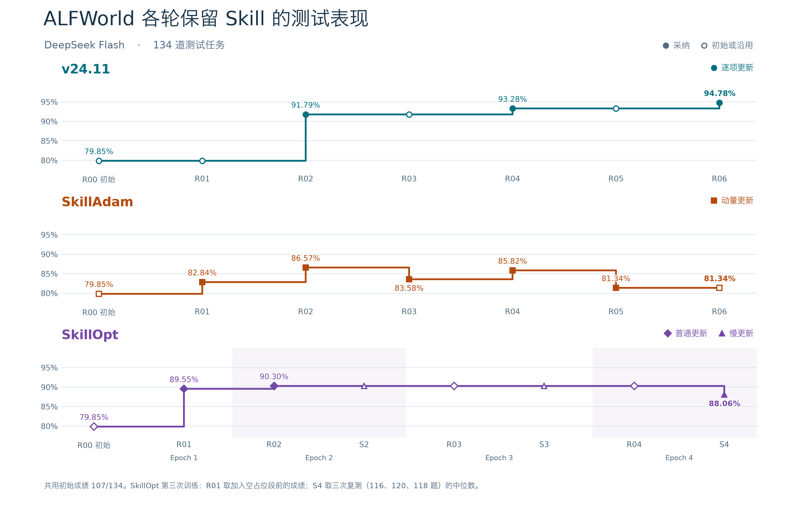
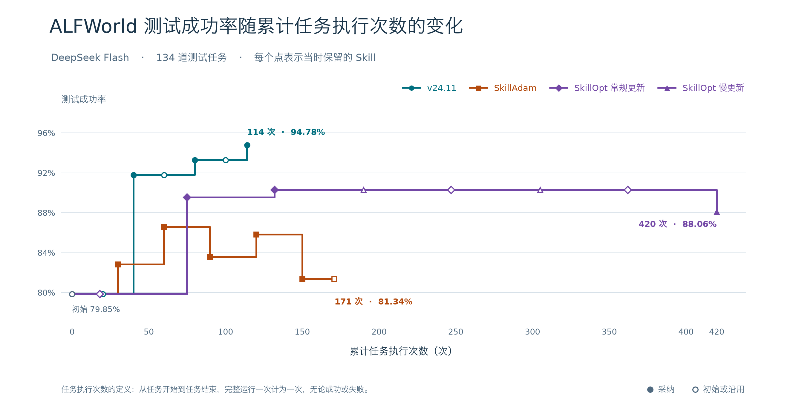

# ALFWorld v24.11、SkillAdam 与 SkillOpt 实验对照

三种方法共用初始 Skill，并在同一组 134 道 ALFWorld 留出题上评测。两张图均采用 DeepSeek Flash 作为 Actor。下表按评测时间列出最终 Skill 的成功题数，SkillOpt 使用训练结束时选出的 Best Skill。

| 训练 | 首测 | 后续复测 | 两图采用的最终值 |
|---|---:|---|---|
| [v24.11](../../../experiments/methods/v24_11/v24_11_alfworld_20261116_124450/README.md) | 127 | 125、125、127、124 | 127/134（94.78%），取首测 |
| [SkillAdam 第一次](../../../experiments/methods/skilladam/alfworld/trajectory_feedback/skilladam_alfworld_v24_9_feedback_20261109_001507/README.md) | 120 | 121 | — |
| [SkillAdam 第二次](../../../experiments/methods/skilladam/alfworld/trajectory_feedback/skilladam_alfworld_v24_9_feedback_rerun_20261109_125648/README.md) | 110 | — | — |
| [SkillAdam 第三次](../../../experiments/methods/skilladam/alfworld/trajectory_feedback/skilladam_alfworld_v24_9_feedback_rerun_20261112_000402/README.md) | 111 | 109、103 | 109/134（81.34%），取三次评测的中位数 |
| [SkillOpt 第一次](../../../experiments/baselines/skillopt_alfworld_native_best_only_20261030_001/README.md) | 120 | 118 | — |
| [SkillOpt 第二次](../../../experiments/baselines/skillopt_alfworld_native_best_only_repeat_20261123_001/README.md) | 117 | 120、121、121（相同文本的逐轮评测） | — |
| [SkillOpt 第三次](../../../experiments/baselines/skillopt_alfworld_native_best_only_third_20261124_001/README.md) | 122 | 116、120、118 | 118/134（88.06%），取三次复测的中位数 |

按各份最终 Skill 成功数最高的一次评测统计，v24.11 成功任务平均用 10.87 步（两次并列最高，取首测）。SkillAdam 三次训练对应的平均步数依次为 9.30、11.65、10.85。

## v24.11 如何选出最终 Skill

每轮由 Parent 和包含本轮全部补丁的 Candidate 各执行一遍同一批任务。Replay 只分析成败翻转的配对轨迹，每题最多归因给一个补丁。一个补丁只获得正向翻转时采纳，只获得负向翻转时拒绝，两种都有或均无归因时暂缓。下一轮使用采纳的补丁组合。[方法与提示词](../../methods/v24_11/README.md) · [正式训练与冻结配置](../../../experiments/methods/v24_11/v24_11_alfworld_20261116_124450/README.md)

| 轮次 | 任务数 | Parent → Candidate 成功数 | 采纳 | 暂缓 |
|---|---:|---:|---:|---:|
| R01 | 10 | 10 → 8 | 0 | 1 |
| R02 | 10 | 7 → 10 | 1 | 0 |
| R03 | 10 | 10 → 10 | 0 | 2 |
| R04 | 10 | 7 → 9 | 1 | 3 |
| R05 | 10 | 10 → 10 | 0 | 1 |
| R06 | 7 | 6 → 7 | 1 | 1 |

六轮共采纳 3 条更新、暂缓 8 条。R01、R03 和 R05 沿用上一轮 Skill。表中的 Candidate 成功数来自全部候选补丁的联合执行；留出集评测使用该轮最终保留的 Skill。

## 逐轮测试与图中取值

R00 共用初始 Skill 的一次复测为 107/134（79.85%）。图中实心点表示采纳更新，空心点表示初始或沿用。各面板按该方法自己的更新顺序排列。[初始 Skill 本地评测摘要](../../../experiments/evaluations/alfworld_v24_10_R00_R01_retest_20261113_133823/R00/summary.json)

- **v24.11** 的 R02、R04 首测都是 129/134。图中取 11 月 24 日复测的 123 和 125，R03、R05 各沿用前一轮。R06 共测五次，图中取首测 127。[九次评测及受测 Skill](../../../experiments/methods/v24_11/v24_11_alfworld_20261116_124450/README.md)
- **SkillAdam** 使用第三次训练。R01 取首测 111，R02 至 R04 取复测 116、112、115。R06 拒绝候选，与 R05 共用最终 Skill，两轮均画在 109/134。[逐轮评测](../../../experiments/methods/skilladam/alfworld/trajectory_feedback/skilladam_alfworld_v24_9_feedback_rerun_20261112_000402/README.md)
- **SkillOpt** 使用第三次训练。R01 取加入空占位段前的候选 120/134，轮末保存的文本另外测得 119/134。R02 取 121/134，此后沿用到 R04 普通更新。第四轮慢更新 S4 发布最终 Skill。[普通更新、慢更新及复测](../../../experiments/baselines/skillopt_alfworld_native_best_only_third_20261124_001/README.md)

## 训练与选优的累计执行题次

每完整执行一道环境任务计一次，同一道题在不同 Skill 下执行会分别计数。纵轴使用独立留出集的成绩，横轴只累计训练与选优中的执行。

| 方法 | 执行题次 | 计数依据 |
|---|---:|---|
| v24.11 | 114 | 57 道优化题各执行一次 Parent 和一次 Candidate |
| SkillAdam | 171 | 57 道题分别执行训练、基线验证和候选验证 |
| SkillOpt | 420 | 初始 Selection 18 次；四轮普通更新各执行 39 道训练题和 18 道 Selection 题；三次慢更新各执行 20 + 20 道对照任务和 18 道 Selection 题 |

## 跨 Actor 评测

换用 GPT-5.4-mini，在同一组 134 道留出题上重新执行各次训练保留的 Skill。下表按受测文本的来源列出首测及后续复测。[本地评测配置与任务清单](../../../artifacts/analysis/alfworld_gpt54mini_final_20261116_200755/manifest.json)

| 受测 Skill | 首测 | 后续复测 | 本地结果 |
|---|---:|---|---|
| [v24.11 R06](../../../experiments/methods/v24_11/v24_11_alfworld_20261116_124450/results/final_skill.md) | 112 | 111、108 | [首测](../../../artifacts/analysis/alfworld_gpt54mini_final_20261116_200755/v24.11/results.jsonl) · [复测 1](../../../artifacts/analysis/alfworld_gpt54mini_final_20261116_200755/v24.11_retest_20261124_144807/results.jsonl) · [复测 2](../../../artifacts/analysis/alfworld_gpt54mini_final_20261116_200755/v24.11_retest_20261125_194338/results.jsonl) |
| [SkillAdam 第三次 R06](../../../experiments/methods/skilladam/alfworld/trajectory_feedback/skilladam_alfworld_v24_9_feedback_rerun_20261112_000402/results/final_skill.md) | 104 | — | [首测](../../../artifacts/analysis/alfworld_gpt54mini_final_20261116_200755/SkillAdam/results.jsonl) |
| [SkillOpt 第二次 Best](../../../experiments/baselines/skillopt_alfworld_native_best_only_repeat_20261123_001/campaign/best_skill.md) | 115 | 114 | [首测](../../../artifacts/analysis/alfworld_gpt54mini_final_20261116_200755/SkillOpt/results.jsonl) · [复测 1](../../../artifacts/analysis/alfworld_gpt54mini_final_20261116_200755/SkillOpt_retest_20261124_151502/results.jsonl) |
| [SkillOpt 第三次 Best](../../../experiments/baselines/skillopt_alfworld_native_best_only_third_20261124_001/campaign/best_skill.md) | 114 | — | [首测](../../../artifacts/analysis/alfworld_gpt54mini_final_20261116_200755/SkillOpt_third_training_20261124_195821/results.jsonl) |
