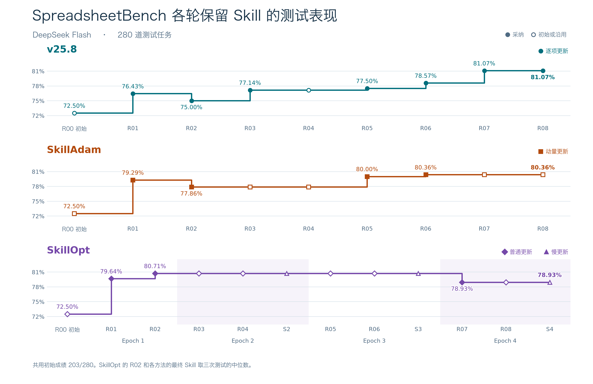
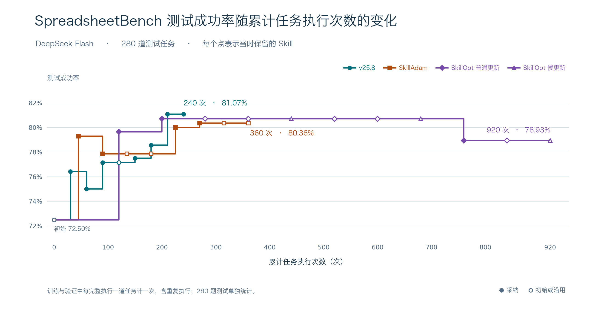

# SpreadsheetBench v25.8、SkillAdam 与 SkillOpt 对照

三种方法用官方 DeepSeek Flash 在同一组 280 道 Test 题上评测。整题成功要求评分区域的全部单元格正确。各方法共用的初始 Skill 在 R00 为 **203/280**。[R00 原始评测摘要](../../../artifacts/analysis/spreadsheetbench_v25_6_skilladam_rounds_20261112/shared_R00/summary.json)

| 方法与运行 | 最终受测 Skill | 图表采用的三次评测 | 中位数 | 训练与验证题次 |
|---|---|---|---:|---:|
| [v25.8 正式运行](../../../experiments/methods/v25_8/v25_8_spreadsheetbench_official_20261118_232447/README.md) | R08 | 228、227、227 | 227/280 | 240 |
| [SkillAdam 11 月 20 日](../../../experiments/methods/skilladam/spreadsheetbench/trajectory_feedback/skilladam_spreadsheetbench_v41_recipe_official_flash_20261120_003006/README.md) | R06 采纳，R07–R08 沿用 | 220、225、230 | 225/280 | 360 |
| [SkillOpt 11 月 22 日](../../../experiments/methods/skillopt/spreadsheetbench/spreadsheetbench_v25_8/README.md) | Selection 选中的 R07，39/40 | 226、220、221 | 221/280 | 920 |

SkillAdam 同一最终 Skill 还完成两次官方线路复测，成绩为 228、225/280。图中沿用前三次的取值规则。三个实验索引均列出实际受测文本和 SHA-256。GPT-5.4-mini 对三份最终 Skill 的评测依次为 180、177、178/280，分别见各运行的完整评测记录。

## 逐轮保留 Skill

- v25.8 的 R01、R02、R03、R05、R06、R07 依次取 214、210、216、217、220、227 题。R04 沿用 R03 的 Skill。
- SkillAdam 的 R01、R02、R05 依次取 222、218、224 题。R03 和 R04 沿用 R02。R06–R08 共用最终 Skill。
- SkillOpt R01 为 223/280。占位前的 R02 共测三次，成绩为 228、220、226/280，图中沿用其中位数 226/280 至第 3 个 epoch 结束。含空慢更新占位的 R02 单独评测为 224/280。R07 采纳后，R08 和第 4 个 epoch 末沿用同一 Skill。

## 训练与验证累计题次

完整执行一题计一次。用两份 Skill 分别执行同一题计两次，Test 评测在表中单独登记。

- v25.8 每轮用 Parent 和 Candidate 各执行 15 题，共 `8 × (15 + 15) = 240`。
- SkillAdam 每轮执行 15 道训练题和 30 道 Gate 验证题，共 `8 × (15 + 15 + 15) = 360`。
- SkillOpt 初始 Skill 验证 40 题，8 次普通更新各执行 40 道训练题和 40 道 Selection 题。3 次慢更新各用两份 Skill 执行同一组 20 题，再执行 40 道 Selection 题，共 `40 + 8 × (40 + 40) + 3 × (20 + 20 + 40) = 920`。
